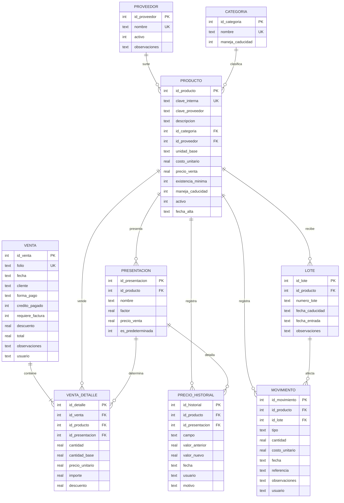

# Modelo de datos

Sistema de control de inventario y análisis de ventas
Depósito Dental HERSON

Estadía profesional, Ingeniería en Sistemas Computacionales, UVEG
Actividad 2 del cronograma: diseño del modelo de datos

El diagrama se mantiene como código para que pueda regenerarse si el
modelo cambia durante el desarrollo. La fuente de verdad del esquema es
el archivo `basedatos/esquema.sql`.

## Diagrama entidad-relación

## Notación

`||--o{` es una relación de uno a muchos donde el lado de muchos es
opcional. Un proveedor puede surtir varios productos o ninguno.

`||--|{` es una relación de uno a muchos obligatoria. Una venta tiene al
menos un renglón, porque una nota sin productos no existe.

`PK` es llave primaria, `FK` llave foránea y `UK` restricción de unicidad.

## Decisiones de diseño

**La existencia no se almacena, se calcula.** No hay columna de
existencia en `producto`. El dato se obtiene sumando los movimientos del
producto, lo que permite explicar en todo momento por qué hay lo que hay.
Guardar la existencia como campo fijo y además registrar movimientos
duplicaría el dato y reproduciría el problema que ya tiene el archivo de
Excel.

**La clave interna sustituye a la del proveedor.** En el inventario
actual hay 248 renglones sin clave y 75 claves repetidas en 316 filas,
porque cada proveedor usa su propia nomenclatura. La clave del proveedor
se conserva en una columna aparte, ya que sigue siendo necesaria para
hacer pedidos.

**Las presentaciones resuelven el mayoreo y el menudeo.** El factor de
conversión indica cuántas unidades base entrega cada presentación, de
modo que la venta de una caja descuente las piezas que contiene. Sin él,
la existencia se descuadra en la primera venta de mayoreo.

**El lote admite nulos.** El número de lote y la fecha de caducidad
vienen en el empaque y en la factura, pero no siempre. Es preferible que
el campo quede vacío y sea visible que falta, a obligar a capturar un
dato inventado.

**El precio se congela en el detalle de la venta.** El importe cobrado se
guarda tal como ocurrió, en lugar de leerse del catálogo, porque los
precios cambian y el histórico debe reflejar la realidad de cada venta.

**El cliente no tiene tabla propia.** Las notas del depósito registran el
nombre solo cuando hay crédito o factura, por lo que se almacena como
texto en la venta. Un catálogo de clientes sería construir algo que el
negocio no utiliza.

**El descuento se guarda por renglón y no por nota.** El propietario
autorizó que quien atiende el mostrador conceda descuentos pero no
modifique el precio, porque un descuento se nota a simple vista y un
precio alterado no. Guardarlo en el encabezado impediría saber sobre qué
producto se concedió, y el margen por producto, que es el indicador
principal del tablero, saldría mal. Cuando se rebaja el total de una
nota, el sistema reparte la rebaja entre los renglones en proporción a
su importe. El total y el descuento del encabezado los recalculan
disparadores a partir del detalle, de modo que no exista una nota cuyo
encabezado no cuadre con sus renglones.

**Cada operación guarda quién la hizo.** En el depósito trabajan tres
personas y el sistema todavía no las distingue, por lo que la columna se
llena con `sin identificar`. Se incorporó desde el inicio porque un
histórico sin autor no puede reconstruirse después, y la separación de
accesos quedó programada para el cierre del proyecto.

**Los cambios de precio dejan constancia.** La regla de no alterar el
precio al vender quedaría sin efecto si el precio del catálogo pudiera
editarse sin rastro, ya que bastaría con modificarlo antes de cobrar.
La tabla `precio_historial` conserva el valor anterior, el nuevo, la
fecha, el autor y el motivo, tanto del precio de venta como del costo,
porque un costo mal capturado desvía el margen igual que un precio.

## Vistas

`v_existencia` entrega la existencia actual por producto a partir de la
suma de movimientos, junto con su categoría, proveedor, costo y precio.

`v_por_reabastecer` filtra los productos activos cuya existencia llegó o
bajó de la mínima configurada, y sustituye la revisión visual de
anaqueles del proceso actual.

`v_caducidad_proxima` lista los lotes con existencia que caducan dentro
de los siguientes 180 días, plazo definido por el propietario.

`v_ventas_plano` entrega una fila por renglón vendido, ya desnormalizada
y con la utilidad estimada calculada, que es la fuente del archivo que
consume el tablero de Power BI. Separa el importe sin rebaja, la rebaja
concedida y el importe cobrado, de modo que el tablero pueda medir
cuánto se descuenta y sobre qué productos. La utilidad parte del importe
ya rebajado, porque el descuento sale de la ganancia.
